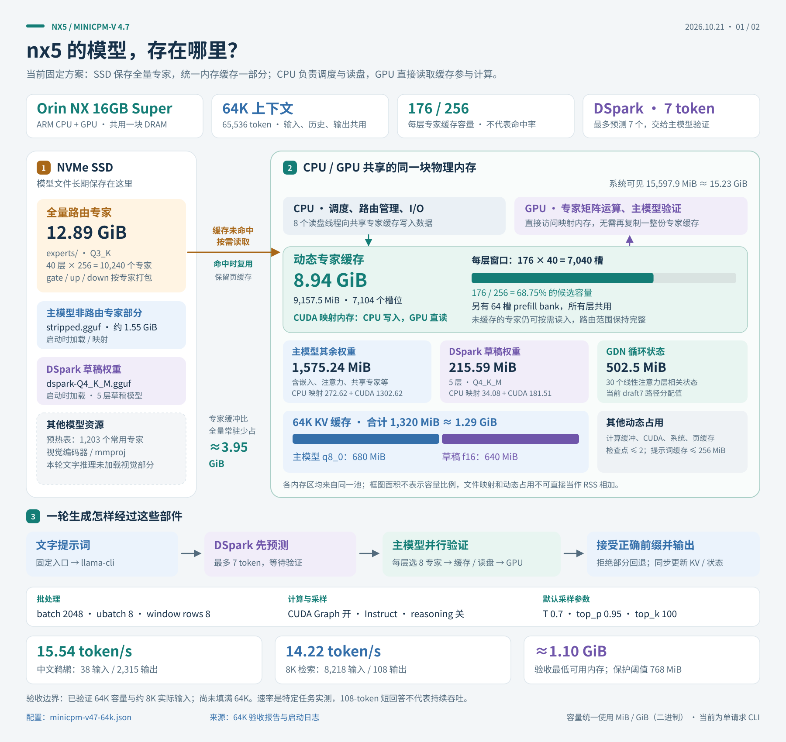
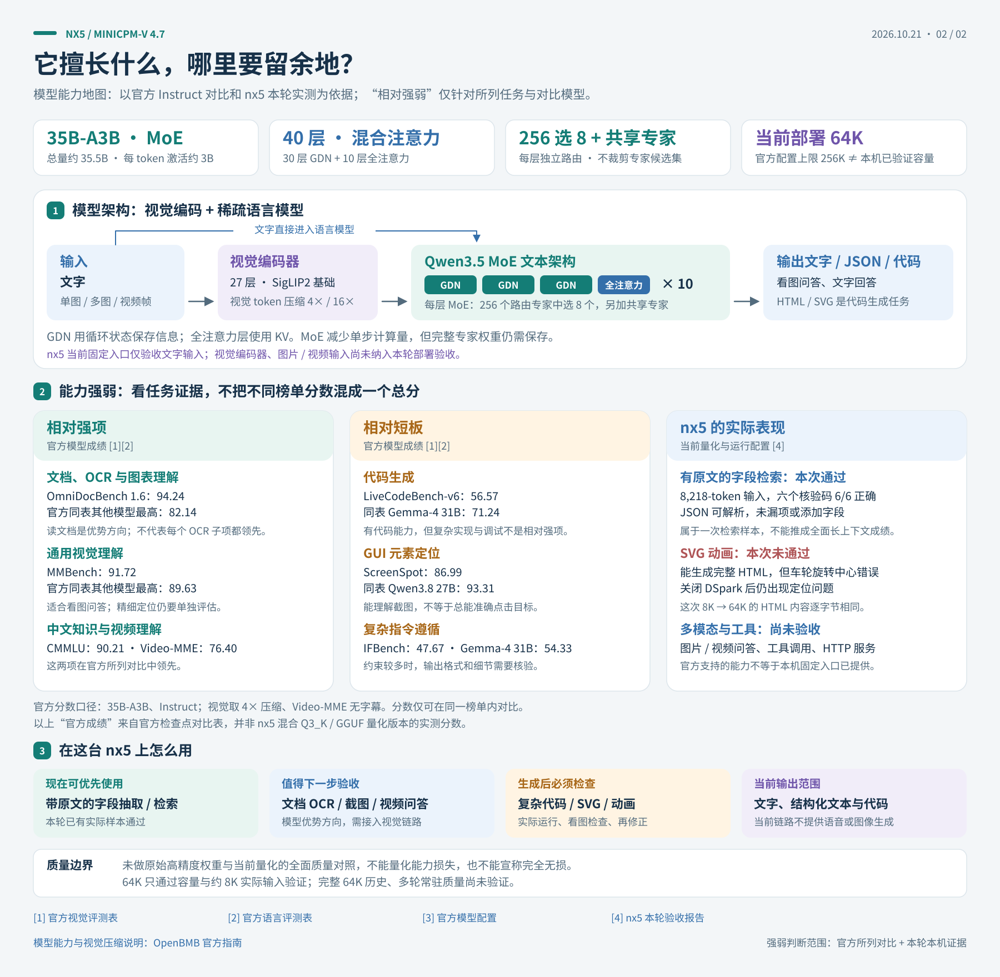

# Jetson Orin NX 16GB 本地大模型部署实录

在 **Jetson Orin NX 16GB Super** 上用 llama.cpp 跑多个模型的完整过程：**坑、实测数据、以及为什么某些"优化"是负收益**。

**鹈鹕测试口径：** 后续对照采用固定英文 SVG 原题、关闭思考，按模型对应参考配置执行，
并列明硬件适配差异。此前中文 HTML 动画题与带思考结果属于自定义实验。
完整规则见 [鹈鹕 SVG 对照测试规范](docs/10-pelican-test-protocol.md)。

**nx5 当前只提供常驻 MiniCPM：** `minicpm-64k` 首次请求加载，后续复用模型、SSD专家窗口和单槽前缀缓存。
空闲继续持有中央GPU独占租约；工具返回时无需重新加载，重复历史按实际token匹配复用。
完整历史仍由客户端发送，改变系统提示或工具定义会影响缓存命中。
入口 `http://nx5.taild500c8.ts.net:18347/v1`，需要Tailscale与专用Bearer令牌；普通聊天默认开启思考。
[舰队能力页](http://nx6.taild500c8.ts.net:8300/capabilities) ·
[调用手册](docs/nx5-service/API.md)。Qwen模型文件与历史实验保留，当前服务不加载Qwen。

**Qwen3.6-35B-A3B MTP（UD-IQ4_XS）已在nx5跑通SSD专家加载：** 约14.53 GiB专家在SSD，
8K / window128 / MTP draft2。关闭思考的英文SVG原题实测 **17.85 token/s，完整输出2分19秒**，
MTP接受率85.0%。修复了MTP缓存视图和Q3_K/IQ3_S等长编码被错误分组的问题。
[原始SVG](reports/2026-10-21-qwen36-nx5/pelican/pelican.svg) 仍有前轮与车架断开、缺少腿脚的问题，
未修图；硬件适配差异和复现入口见 [Qwen SSD部署记录](docs/11-qwen36-nx5-ssd-20261021.md)。

**Qwen也已跑通128K容量：** 保持window128 / MTP draft2，标准SVG生成**17.31 token/s**，
输出与8K逐字节一致；实际8218-token输入检索六项全对，最低可用内存1.93 GiB。
已保存独立128K参数，**尚未测试填满128K**。详见[128K验证与入口](docs/12-qwen36-128k-20261021.md)。

**nano5（Orin Nano 8GB）也已跑通同一份 MiniCPM 权重：** 专家缓冲缩小到约 2.50–2.90 GiB，
完整 12.89 GiB 专家文件仍在 SSD，全部专家均可参与路由。512-token 短测中，
8K / window56 / draft3 达到 **6.69 token/s**；64K / window48 / 关闭 DSpark 达到 **5.63 token/s**。
64K 仅验证容量与短输入，尚未验证实际长历史。运行入口为
[run-nano5.py](scripts/minicpm/run-nano5.py)，部署路径、互斥服务与完整数据见
[nano5 部署验证](docs/09-nano5-deployment-20261021.md)。
HTTP异步服务已上线，与原ComfyUI **SDXL**互斥；任务完成后释放MiniCPM内存，已切回原业务。
[舰队调用手册](http://nx6.taild500c8.ts.net:8300/agent/nano5-minicpm.md) · [本地API说明](docs/nano5-service/API.md)。
完整鹈鹕生成6分30秒，但画面错位；原图OCR157秒，密集小字有识别错误，不能只按调用成功判断质量。

**nx5 当前固定配置为 64K：** window176 / bank64 / DSpark draft7 / GPU 映射专家缓存。
容量短测 **17.16 token/s**；实际输入 **8218 token** 的检索测试六项全对，回答 **14.22 token/s**，
最低可用内存约 1.10 GiB。固定入口的中文原题完整生成 **15.54 token/s、2 分 41 秒**，
HTML 与前轮 8K/GPU/draft7 逐字节一致。已验证 64K 容量与约 8K 实际输入，尚未测满 64K。
使用 [run-64k.py](scripts/minicpm/run-64k.py)，参数与验收见
[64K 固定配置](docs/08-nx5-64k-fixed-20261021.md)。旧启动 preset 保留作历史记录。

**[下载 5 页 PDF 图册](docs/diagrams/nx5-minicpm-64k-architecture-and-capabilities.pdf)**：
两张本机图解，以及 OpenBMB 官方的性能效率、视觉能力、语言与代码能力三张高清原图。
PDF 包含页面书签与官方来源链接，区分官方检查点成绩、本机实测和未验证能力。

**存储部署与 64K 固定参数**（[SVG 原图](docs/diagrams/nx5-minicpm-64k-storage.svg)）：



**模型架构与能力范围**（[SVG 原图](docs/diagrams/nx5-minicpm-capabilities.svg)）：



两张 SVG 支持无损放大和编辑；同目录提供 PNG 预览。
PDF 图表来源与校验记录位于 [图解归档](reports/2026-10-21-nx5-diagrams/sources.json)。

前轮 8K 优化让原本落在 CPU 的流式专家矩阵乘法直接使用 GPU 映射内存，
再配合 DSpark。1024-token 短测达到约 **18 token/s**；用户中文原题完整生成实测
**16.55 token/s、端到端 2 分 32 秒**，最低可用内存约 1.13 GiB。
补丁、独立运行入口和对照结果见 [8K CUDA / DSpark 实测](docs/07-nx5-cuda-optimization-20261021.md)。
本次原始 HTML 仍有车轮旋转定位错误；性能提升不能当作视觉质量提升。

本文保留部署过程和历史实验。**2026-10-21 的 SSH 复核推翻了部分旧结论**：当前 CLI 有投机循环，
DSpark 正确路径的接受率可达 82%，`SKIP_READ` 不是正确推理的硬件上限，64K 也不必固定窗口 96。
首轮修复了 bank 小于窗口时的数组越界，64K/window216/bank64 完整生成实测 **14.05 token/s**。
请优先阅读 [nx5 源码与性能复核](docs/06-nx5-audit-20261021.md)。以下旧内存表不能作为可用余量的依据。

用户原题“鹈鹕骑自行车”实测 **13.44 token/s，端到端 3 分 33 秒**。
[原始 HTML](reports/2026-10-21-nx5-audit/pelican-user/pelican.html) 可以打开，但动画覆盖定位导致画面错位，
本次视觉任务未通过；[浏览器截图](reports/2026-10-21-nx5-audit/pelican-user/frame-700.png) 保留真实结果。
后续改用官方 instruct 采样，[新结果](reports/2026-10-21-nx5-quality/instruct/pelican.html) 解决了错位、实测 13.71 token/s，
但仍缺完整蹬踏动作。已逐字节确认专家拆分未丢数据；量化能力损失尚无高精度对照，不能仅凭单张图判定。
随后已跑通 **128K 容量、window200、bank64**：短输入完整输出 2529 token，12.45 token/s，
最低可用内存 835 MiB；尚未填满 128K 历史。复现参数和适用范围见复核报告的“128K 上下文容量验证”。

---

## nx5 OpenWebUI / OpenAI 兼容接口

**OpenWebUI 已配置：** [打开聊天页面](http://nx6.taild500c8.ts.net:18348)。登录后可在模型下拉菜单选择
`minicpm-64k`。登录凭据单独保存在管理员的私有配置目录，不入库。
内置工具与后台自动生成已关闭；输出上限7680，其他采样参数沿用各模型固定配置。
历史Qwen配置曾保存鹈鹕参考默认值：temperature 0.7、top-p 0.8、presence penalty 1.5；top-k 20、min-p 0、repeat penalty 1由后端生效。
每条新回复完成后显示生成TPS、生成耗时和含模型加载的总耗时；回复下方ⓘ可查看token数及详细统计。
部署、登录凭据位置和网页验收见[OpenWebUI使用说明](docs/15-openwebui-20261021.md)。

OpenWebUI 管理员连接填写 Base URL `http://nx5.taild500c8.ts.net:18347/v1`，
API Key 使用 nx5 服务专用令牌（管理员从 `~/.config/nx5-ssd-llm/client.key` 安全提供）。
OpenWebUI 后端/容器须能访问 Tailnet。模型列表只发现 `minicpm-64k`。
支持文本多轮聊天、真实 SSE 流式、采样参数和 token 用量；模型首次加载后常驻，
Chat及原有 `/v1/jobs` 共用一个 GPU 准入槽位。Chat 忙时429，不会并行加载或杀掉正在运行的任务。
关闭 OpenWebUI 自动标题/标签等后台模型任务，避免和聊天争用资源。
当前接口支持函数工具调用及工具结果回传，工具由 Octop 等客户端执行；不支持图片，支持单槽跨请求前缀缓存；思考可在输入框旁“模型控件”中切换，普通聊天默认开启，标准测试选择关闭。
当前账号已开启“始终展开详细信息”，思考内容实时展开显示。详细配置、恢复规则和 SDK 示例见
[调用手册](docs/nx5-service/API.md)和[发布验收](docs/14-nx5-openai-service-20261021.md)；舰队页面为 `http://nx6.taild500c8.ts.net:8300/capabilities`。

## Octop 智能体

[打开 bus002 Octop](http://bus002.taild500c8.ts.net:8088)，在聊天模型选择器中选择 `nx5-local` 下的
**NX5 · MiniCPM-V4.7 35B-A3B · 64K**。
思考默认开启，支持工具调用和结果回传；模型与上下文缓存跨请求保留。
Octop默认模型为MiniCPM；原有 `siyuan-nx6` 连接不变，nx5连接移除Qwen选项。
配置、网络及旧版验收见 [Octop 接入说明](docs/16-octop-20261022.md)，当前接口语义见[调用手册](docs/nx5-service/API.md)。

## 硬件与环境

| 项 | 值 |
|---|---|
| 机器 | Jetson Orin NX 16GB Super（p3768 + p3767-0000-super，tegra234）|
| 内存 | **15 597 MiB 统一内存**（GPU 与 CPU 共享同一块）|
| GPU | sm_87，1024 CUDA core，上限 **1173 MHz** |
| CPU | 8× Cortex-A78AE，上限 **1984 MHz** |
| 实测内存带宽 | **93–95 GB/s**（自定义 CUDA 读核，2 GiB，1024×256）|
| 系统 | Ubuntu 24.04.4 LTS，L4T R39.2.1，CUDA 13.2，driver 595.78 |
| 电源 | MAXN_SUPER |
| 系统目标 | `multi-user.target`（无图形界面）|

**统一内存是整个工程的约束来源**：15.6 GB 要同时装权重、KV cache、计算缓冲和操作系统。

---

# 第一部分：Qwen3.8-27B（dense + MTP）

## 结论

| 项 | 值 |
|---|---|
| 模型 | `Qwen3.8-27B-UD-IQ2_XXS.gguf`（6.77 GiB）|
| MTP | `mtp-Qwen3.8-27B-Q4_0.gguf`（1.28 GiB sidecar，draft=3）|
| 上下文 | **131072（128K）**，q4_0 KV |
| **decode** | **6.6–7.2 tok/s** |
| prefill | 105.8 tok/s |
| 进程 RSS | 9.96 GB |

## 架构

`qwen35` 架构，**dense**，27.32B 激活参数，65 块（64 + 1 MTP），
**48 层 GDN（线性注意力）+ 16 层全注意力**（`full_attention_interval=4`），
24 Q head / 4 KV head，key/value length 256。

## 关键发现：瓶颈是延迟，不是带宽

把模型从 11.29 GiB 换成 6.77 GiB（**小 40%**），decode 只从 4.20 涨到 4.23 t/s（**+5%**）。

如果受带宽限制，应该接近 +67%。所以瓶颈是**每 token 的固定串行延迟**：
GDN 是严格递归的，每 token 必须串行走完 64 层，无法并行摊薄。

**推论：在这个模型上做权重量化，节省的 I/O 几乎换不到速度。**

## 唯一有效的加速：MTP 投机解码

| 配置 | decode |
|---|---:|
| IQ3_S 11.29 GB，无 MTP | 4.20 tok/s |
| IQ2_XXS 6.77 GB，无 MTP | 4.23 tok/s |
| **IQ2_XXS + MTP draft=3** | **6.6–7.2 tok/s** |

MTP 一次前向验证多个草稿 token，把固定延迟摊薄 —— 这才是对症的药。

> MiniCPM 的正确 DSpark 路径已测到约 82% 接受率，但本轮 draft=3 的整体速度与关闭时接近。
> 接受率和实际吞吐必须分别测量，不能仅凭架构判定收益。

---

# 第二部分：MiniCPM-V 4.7 35B-A3B（MoE + LES）

## 架构（直接从 GGUF 元数据读的）

| 类别 | 参数 | 值 |
|---|---|---|
| 规模 | 总层数 | 40 |
| | 总参数 / **每 token 激活** | 35.5 B / **≈3 B** |
| 注意力 | **GDN 线性层** | **30** |
| | 全注意力层 | **10** |
| | 模式 | `GGGF` 循环（`full_attention_interval=4`）|
| | 头数 Q / KV | 16 / **2**（GQA 8:1），head_dim 256 |
| MoE | 每层专家数 / 激活数 | **256 / 8** + 1 shared |
| | 单专家 FFN 维 | 512 |
| GDN 状态 | conv_kernel / state_size / time_step_rank | 4 / 128 / 32 |

**只有 10 / 40 层存 KV cache**，所以长上下文非常便宜：
64K 上下文 q8_0 KV 只占 **0.68 GB**。

## 为什么专家必须放 SSD

| 项 | 大小 |
|---|---:|
| 非专家权重（`stripped.gguf`）| 1.55 GB |
| **专家权重（`experts/`，40 层 × 256 专家）**| **12.89 GB** |
| 统一内存池 | 15.6 GB |

全部专家加上非专家权重、运行缓冲和系统开销无法同时装入，所以 LES 把专家放 NVMe，用 `preadv` 按需读进内存槽位，
并维护一个每层的解码缓存窗口。

**每 token 激活 40 层 × 8 专家 ≈ 412.5 MiB 权重；这是全部未命中时的读取需求。窗口命中不读，页缓存命中也不访问 SSD。**

## 历史基线配置（非当前最优的证明）

```bash
LLAMA_MOE_DECODE_WINDOW=224      # 每层 224 槽（关键）
LLAMA_MOE_BANK_CAP=224
LLAMA_MOE_SLOT_BANK=400          # prefill 段，不要设大
LLAMA_MOE_IO_THREADS=8
LLAMA_MOE_WINDOW_MAX_ROWS=1
LLAMA_MOE_PREWARM=prewarm_top128.txt
llama-cli --moe-slot-bank 400 \
  --cache-type-k q8_0 --cache-type-v q8_0 \
  -ngl 99 -fa on -c 8192 -b 2048 -ub 8
```

| 场景 | Prefill | **Generation** | 输出完整 |
|---|---:|---:|:---:|
| 生成 8 KB HTML+SVG 动画（n=3000）| 7.6 t/s | **13.6 t/s** | ✅ |
| 同上，`-b 8` | 6.4 t/s | 13.4 t/s | ✅ |
| 同上，window=96（旧配置）| 14.2 t/s | **9.7 t/s** | ✅ |
| 短输出（n=250，计数）| 5.4–6.3 | 7.2–8.6 | — |

**同一个任务，window 224 比 window 96 快 40 %（13.6 vs 9.7）。**

### 64K 长上下文预设

| 上下文 | window | 峰值 RSS | decode |
|---:|---:|---:|---:|
| 8 K | 224 | ~7.7 GB | **13.6 t/s** |
| 64 K | 96 | 10.3 GB | 11.2 t/s |

上表的内存归因已撤回：64K 相比 8K 的 q8_0 KV 只增加约 595 MiB，其他差额必须另查。
本轮已完成 64K 容量、窗口 208、bank 400 的 2048-token 测试；原 `MCP_PRESET=long` 仍保留旧参数。
详见[复核](docs/06-nx5-audit-20261021.md)，尤其注意容量与实际历史长度的区别。

### 跳读诊断的局限

历史 `SKIP_READ=1` 测到 15.2–15.3 t/s，但源码在该模式下没有填充专家权重，输出和路由都会改变。
`DUMMY_READ=1` 同样不更新真实专家缓冲。这些数字只能辅助诊断，**不能作为正确推理的硬件上限**，
也不能据此断言达到 15 t/s 必须让全部专家常驻。

## 历史补丁与参数说明

全部在 `patches/0001-les-linux-support.patch`（5 文件，+188 / −6）。

### 1. `F_NOCACHE` 是 macOS 专有

上游用 `fcntl(fd, F_NOCACHE, 1)`。Darwin 的 fd 级常驻标志，Linux 没有等价物。

Linux 下用 `posix_fadvise(POSIX_FADV_DONTNEED)`，而且**只在 fd 打开时调一次不够**：
它只在那刻生效，之后读进来的页照样堆积。12.89 GB 专家会把 page cache 吃满，
与进程 pinned 槽位缓冲叠加后超过物理内存 → OOM。

> 但注意：**最终配置里刻意保留 page cache**（`LLAMA_MOE_F_NOCACHE=0`，默认）。
> 因为我们后来发现 5.5 GB 页缓存里存着专家数据，命中就是零延迟，比"干净内存"更快。

### 2. CUDA 没有 `alloc_only_buft`

专家张量内容由 `preadv` 运行时写入，要求**CPU 可写 + GPU 可读**。
Metal 提供专用的 `alloc_only_buft`，CUDA/CPU 没有。
回退到 `ggml_backend_dev_host_buffer_type()`（CUDA pinned 内存）。

### 3. DSpark 的驱动接线

DFlash/DSpark 草稿模型借用目标模型的 embedding 和 lm_head，需要 `ctx_other`。
当前实际 CLI 使用 `tools/cli` 和 `server-context`，该路径已经完成初始化与特征注入。
原来针对 `tools/main/main.cpp` 的判断不适用于这个二进制。
`llama-speculative-simple` 的原有本地补丁只补初始化，没有补 DSpark 必需的
`common_speculative_process()`；不要再用其低接受率判定模型能力。

### 4. `--moe-slot-bank` 不是总缓存大小（最容易误解）

每层的物理 base 布局是：

```
[0, prefill_cap)          ← prefill 段，容量 = --moe-slot-bank
[prefill_cap, +各层宽度)  ← decode 段，容量 = DECODE_WINDOW × 层数
```

本机 `-ub 8` 时，每个 ubatch 只有 8 个 token，专家并集 ≤ 64 槽，
所以 `--moe-slot-bank` 给 400 就很宽裕，**给 6400 是纯浪费**。

实测（8K 上下文）：

| `--moe-slot-bank` | window | 峰值 RSS |
|---:|---:|---:|
| 6400 | 128 | 8.0 GB |
| 3200 | 160 | **15.6 GB（几乎占满）** |
| **400** | **224** | **~7.7 GB** |

上表来自不同历史实验，内存数值尚未统一口径。专家缓冲随
`bank + 各层窗口之和` 增长，两者都重要。224 槽加 bank 400 本身就约 11.78 GiB。

### 5. `LLAMA_MOE_BANK_CAP` 只检查 prefill bank

源码条件是 `bank <= BANK_CAP × 40`，并不限制全部专家缓冲，也不要求 cap ≥ window。
真正的内存约束还包括窗口、目标模型、draft、KV、计算缓冲和系统。

## DSpark 与驱动现状（2026-10-21 复核）

| 驱动 | 状态 |
|---|---|
| `llama-cli`（实际入口 `tools/cli`）| 复用 `server-context`，已实测启用 DSpark |
| `llama-server` / 恢复的 `llama-les-server` | 旧 HTTP 外层仍有 API 漂移，本轮没有发布 HTTP 服务 |
| `llama-speculative-simple` | 原接线缺少目标特征注入，其 0.8%–5.4% 接受率不代表正确 DSpark |

现有 CLI、draft=3：256-token 短测接受率 **76.3%**；2048-token 长测接受率 **82.0%**，
生成速度 **13.24 t/s**。接受率恢复并不等于一定提速，需同任务、同窗口的长输出对照。
旧的“SSD 场景投机必然负收益”“代码/HTML 接受率必低”“CLI 没有投机循环”结论均撤回。
完整测量与适用范围见[复核报告](docs/06-nx5-audit-20261021.md)。

## 真正有效的三个优化

| 手段 | 效果 |
|---|---|
| `LLAMA_MOE_PREWARM`（热专家表）| **12.4 → 14.5 t/s（+17 %）** |
| `LLAMA_MOE_IO_THREADS` 1 → 8 | **10.2 → 14.5 t/s** |
| decode window 96 → 224 | **9.7 → 13.6 t/s（真实任务）** |

### 预热表

`LLAMA_MOE_PREWARM=<file>`：每行一层，行内是专家 id。
启动时先读进解码窗口，消除首 token 的全 miss。

采集方法：`LLAMA_MOE_SWEEP=<file>` 记录每步每层真实路由，统计热度取 top-N。

**专家热度高度集中**：每层 256 个专家里常用的只有约 100 个
（layer0 top-32 覆盖 78.6 %，top-64 覆盖 100 %）。

### IO 线程数不能降到 1

直觉上"降低并发减少争抢"是错的：

| 线程 | Generation |
|---:|---:|
| **1（串行）** | **10.2** |
| 2 | 12.9 |
| 4 | 14.4 |
| 8 | 14.5 |

SSD 必须并发才能打满带宽。

---

# 第三部分：测量方法学（这一节最容易被忽略）

在统一内存 + SSD 流式的场景下，**同一个配置测出来能差一倍**。
以下五个因素控制不好，数据就毫无意义。

## 1. 输出长度决定测出来的速度

前约 50–100 个 token 全是冷 miss（`hit=0`），严重拉低平均值。

| 输出长度 | 测得 Generation |
|---:|---:|
| 250 token | **7.2–8.6 t/s** |
| 1200 token | **10.5 t/s** |
| 3000 token | **13.4–13.6 t/s** |

**报告速度必须同时报告输出长度。**

这条直接改变了我的结论：用 n=250 的短测试对比 window 96 和 224，
得到 "10.5 vs 11.2，差不多"；换成 n=3000 的真实任务，
变成 **"9.7 vs 13.6，差 40 %"**。短测试被冷启动主导，完全无法区分配置优劣。

## 2. 孤儿进程会静默毁掉一切

一个残留的 `llama-cli` 会**钉住整个专家 bank**（实测 **14.8 GB** / 15.6 GB 池）。
后果：后续所有运行 OOM，速度数字毫无意义。

现象：`free` 显示 `used 15044 MB, available 553 MB`，但 `ps` 里没有明显可疑项
（父进程已退出，进程被 init 收养）。

历史 `prep-system.sh` 会全局 `pkill -9 -x llama-cli`，可能误杀活跃任务。
本轮测量改用互斥锁、已有进程检查和只结束自身进程组的生命周期管理，见 `scripts/minicpm/bench-audit.py`。

## 3. page cache 是有用的，不要清

跑之前 `echo 3 > drop_caches` 是**自残**：5.5 GB 页缓存里存着专家数据，
命中就是零延迟。清掉之后测量必然偏慢。

## 4. 不要在自己测的时候让别人也在这台机器上跑

开发过程中遇到过外部脚本循环（每轮开头 `pkill -9 -x llama-cli`），
把所有测量都变成了随机数。**测速前先确认机器是空的。**

## 5. 后台服务不是内存问题

实测：**所有进程的匿名内存加起来只有 53 MB。**

`free` 报的"已用 2.6 GB"里，约 2.2 GB 是 Jetson 内核 / CUDA 驱动预留，
关任何服务都回收不了。系统已经是最简：`gdm` 未运行、`docker` 未运行、
`multi-user.target`。

---

# 第四部分：系统配置

## 必须做的四件事

| 动作 | 原因（都是实测）|
|---|---|
| `swapoff -a` + `vm.swappiness=0` | 2 GB swapfile 曾被启用且占用 600 MB；几百 MB 被换出就把 90 ms 的 decode 变成秒级 |
| 停止并禁用 `jtop` | 每秒轮询 GPU/CPU 频率，扰动 governor 和任何计时 |
| `jetson_clocks` | 不做的话 CPU 空闲时掉到 **729 MHz**；锁到 1984 MHz CPU / 1173 MHz GPU |
| 杀残留 `llama-cli` | 见上文，单个孤儿占 14.8 GB |

已固化为 `systemd/minicpm-prep.service`，开机自启。

## 反向教训：这些做了没用

| 尝试 | 结果 |
|---|---|
| KV cache 量化（f16 → q8_0 → q4_0）| **无感**。64K 上下文 KV 只有 0.68 GB，不是瓶颈 |
| mmproj 移到 CPU（`--no-mmproj-offload`）| **无感**。1 GB 视觉编码器不是瓶颈 |
| 把 `--moe-slot-bank` 加到 6400 | **更慢**（白占 8 GB，window 反而被挤小）|
| 降到单线程读盘 | **更慢**（10.2 vs 14.5）|
| 用普通 CPU 内存替 pinned | **CUDA 崩溃** |
| 恢复 `llama-server` 目标 | 编不过（API 漂移）|
| 旧 DSpark 测试 | 驱动接线和入口判断有误；正确 CLI 已测到 82% 接受率，速度须重新对照 |

---

# 仓库内容

```
.
├── README.md                       ← 本文
├── docs/
│   ├── 01-environment.md           # 机器、工具链、CUDA 版本
│   ├── 02-build.md                 # KVMem 编译（含 Jetson 补丁）
│   ├── 03-benchmarks.md            # Qwen3.8 实测数据
│   ├── 04-service.md               # Qwen3.8 服务与参数
│   ├── 05-minicpm.md               # MiniCPM 部署与调优（英文）
│   └── minicpm-les-notes.md        # LES 调优笔记（另一轮独立实验）
├── patches/
│   └── 0001-les-linux-support.patch   # 让 llama.cpp-omni 在 Linux/Jetson 上跑起来
├── scripts/
│   ├── env.sh / start.sh / start-fg.sh / stop.sh / rebuild.sh   # Qwen3.8
│   ├── start-minicpm.sh            # MiniCPM 另一版启动脚本（window=224）
│   ├── bench_4k.py / bench_ctx.py / stability.py / mtpbench.py
│   └── minicpm/
│       ├── env.sh                  # MiniCPM 全部调优参数（fast / long 两套预设）
│       ├── prep-system.sh          # 系统优化（swap / jtop / clocks / 杀孤儿）
│       ├── start.sh                # 一条命令启动
│       └── prewarm_top128.txt      # 热专家预热表（40 层 × 1203 专家）
├── systemd/
│   └── minicpm-prep.service        # 开机自动做系统优化
└── samples/
    ├── pelican.html                # 模型生成的鹈鹕骑自行车 SVG 动画
    └── pelican.png                 # 渲染截图
```

## 复现步骤

```bash
# 1) 编译带补丁的 fork
git clone https://github.com/tc-mb/llama.cpp-omni
cd llama.cpp-omni && git checkout a64932e
git apply /path/to/patches/0001-les-linux-support.patch
cmake -S . -B build-jetson -G Ninja -DCMAKE_BUILD_TYPE=Release \
  -DCMAKE_CUDA_COMPILER=/usr/local/cuda/bin/nvcc \
  -DCMAKE_CUDA_ARCHITECTURES=87 -DGGML_CUDA=ON -DLLAMA_CURL=OFF
cmake --build build-jetson -j6 --target llama-cli

# 2) 把专家权重剥离成 experts/（40 层 × 256 专家）+ stripped.gguf
#    参考 docs/02-build.md

# 3) 系统优化
sudo cp systemd/minicpm-prep.service /etc/systemd/system/
sudo systemctl enable --now minicpm-prep.service

# 4) 跑
cd scripts/minicpm
./start.sh -p "hello" -n 256
MCP_PRESET=long ./start.sh -p "hello" -n 256   # 64K 上下文
```

## 样例输出

模型一次生成、未修改的 `samples/pelican.html`（6959 字节，`<!DOCTYPE html>` → `</svg>` 完整闭合）：


---

## 已知限制

- 全部专家、目标模型、运行缓冲与操作系统难以共同放进 15.6 GiB，需要流式加载。
- 15.3 t/s 是错误权重路径的诊断值，不是硬件极限。
- 分配 64K 容量不等于已经验证接近 64K 实际历史时的速度。
- 尚无经过本轮验收的 HTTP 服务；DSpark 可直接使用现有 CLI，无须先修 HTTP。
- 单个 HTML 提示词的测量不代表多任务质量、长期稳定性或所有路由工作集。

---

## 数据来源标注

- **本文主表**：本人受控实测（`pkill` 残留进程、`resource.getrusage` 读峰值内存）。
- `docs/minicpm-les-notes.md`：另一轮独立实验的笔记。它先发现了
  `bank=400 / window=224` 这个更优结构；本文已亲自复测并确认
  （n=3000 真实任务：13.4–13.6 t/s，输出完整）。两处数值差异主要来自输出长度
  与 page cache 状态，详见第三部分。
