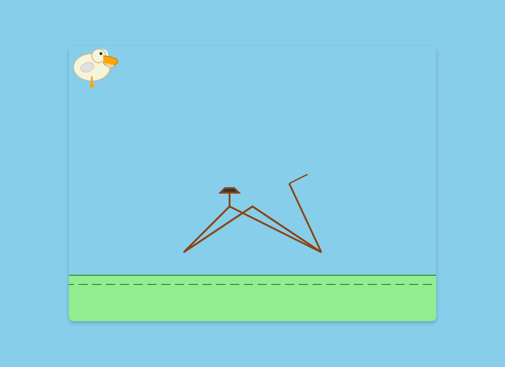

# nx5 源码与性能复核（2026-10-21）

本轮通过 `ssh nx5` 检查实际二进制、Ninja 构建命令、源码和运行记录，并进行串行实测。
引擎是 `/home/nx/github/qwen38-kvmem/minicpm-les/llama.cpp-omni`，提交 `a64932e`，含原有本地补丁。
没有替换生产二进制，没有升级引擎，没有修改系统频率，也没有杀其他推理作业。

**后续进展：** 用户要求优先测试 8K 后，已发现原专家计算落在 CPU 的问题，
新增 CUDA 映射专家补丁并重新评估 DSpark。最新参数、正确性验证和结果见
[8K CUDA / DSpark 提速实测](07-nx5-cuda-optimization-20261021.md)。下文保留首轮证据与历史结论。

## 原记录需要纠正的结论

1. **当前 `llama-cli` 有投机循环。** `ninja -t commands llama-cli` 显示实际入口是
   `tools/cli/main.cpp` → `tools/cli/cli.cpp` → `tools/server/libserver-context.a`。
   原先检查的 `tools/main/main.cpp` 不是这个二进制的入口。
   `server-context.cpp` 已创建 `ctx_other`，加载 draft，调用 `common_speculative_process()`，执行验证与回滚。
2. **原 `llama-speculative-simple` 的 DSpark 测试缺少关键接线。**
   它在初始化 speculator 之前做 prefill，并直接对 draft 做普通 token decode；没有调用
   `common_speculative_process()`。DSpark 需要该函数提取目标层的输入状态、编码并注入 draft KV。
   所以 0.8%–5.4% 不能代表正确 DSpark 路径。本轮现有 CLI 的 draft=3 短测达到 76.3%，
   2048-token 长测达到 82.0%，不需要移植 HTTP server 才能启用。
3. **`SKIP_READ` 不是正确推理的硬件上限。** `llama-moe-slot.cpp:1476` 起的实现明确跳过数据写入，
   把未填充/陈旧的专家内容当作已加载；源码自己注明输出错误。其路由、输出、工作集也会改变。
   它可以辅助定位开销，但 15.3 token/s 不能当作物理极限，也不能据此推算另一台机器的速度。
   `DUMMY_READ` 同样不更新真实专家缓冲，不能当作正确推理的等价对照。
4. **约 412.5 MiB/token 是专家全部未命中时的需求，不是每 token 的 SSD 读取量。**
   `320 × 1,351,680` 字节是激活专家大小；窗口命中不读，页缓存命中也不读 NVMe。
   热运行日志出现 `miss=0 hit=320` 和 `miss=1 hit=319`。
   LES 的累计 `pread` 字节还混入 warmup、预热与 prefill，且不等于物理设备流量。
5. **8K/224 的 7.7 GB 峰值不能沿用。** 本轮 8K/224 的最低整机 `MemAvailable` 是 490 MiB；
   CUDA、pinned 映射和进程 RSS 必须分清，不能用单个 RSS 数字推断还有一半物理内存可用。
6. **64K 不必固定窗口 96。** 本轮已完成 64K 容量、窗口 208、bank 400 的 2048-token 测试。
   这不代表填满 64K：实际提示词只有 108 token，分配容量和实际历史长度是两种测试。

源码证据：`tools/cli/CMakeLists.txt`、`tools/server/server-context.cpp:922,1079,3439`、
`common/speculative.cpp:844,908,940`、`examples/speculative-simple/speculative-simple.cpp:147,162,250`。
行号对应本次 nx5 源码快照，后续升级可能变化。

## 内存预算

这份专家包每个专家占 1,351,680 字节，即 1.2890625 MiB。
各层窗口可以通过已有的 `LLAMA_MOE_LAYER_WINDOWS="0:224,1:192,..."` 分配不同宽度。
专家缓冲总量近似为：

```
1.2890625 MiB × (prefill bank + 各层窗口之和 + 预取槽之和)
```

| 均匀窗口 | prefill bank | 专家缓冲约占用 |
|---:|---:|---:|
| 224 | 400 | 11.783 GiB |
| 208 | 400 | 10.977 GiB |
| 192 | 400 | 10.172 GiB |
| 176 | 64 | 8.943 GiB |

因此 bank 和窗口都影响内存，不能说“bank 才是主因，window 不是”。
`LLAMA_MOE_BANK_CAP` 的源码检查仅约束 `bank <= cap × 40`，不是实际总内存上限，
也没有要求它大于窗口；启动脚本设得较大只是保守习惯。

以 10 层、2 个 KV head、head_dim 256、K/V 都为 q8_0 估算，64K 的 KV 为 680 MiB，
8K 为 85 MiB，差 595 MiB。若测得总内存多 2.6 GB，其余部分不能统称为 KV，
还要检查计算缓冲、draft、回滚状态、并发槽和专家 bank。
把 bank 从 400 缩到 64 可释放 433.125 MiB；固定 `ubatch=8` 时每层最多涉及 64 个专家。
但原运行时有数组越界，**必须先应用下面的补丁**。增大 ubatch 时必须重新计算这个下限。

## 已修复：bank 小于窗口时越界

原 `impl` 构造函数按 prefill bank 分配 `slot_to_expert` 和 `slot_age`；
`resolve_decode_window()` 设置更大的 `window_width` 后没有扩大这两个数组。
`process()` 在窗口模式下访问到末尾时发生越界。64K/window176/bank64/draft3 在 prefill 阶段
稳定复现 SIGSEGV；gdb 栈顶为 `llama_moe_slot_runtime::process()`。
只把 bank 改回 400，同样的请求即可完成。

[补丁 0002](../patches/0002-les-window-slot-metadata.patch) 让两个索引数组容纳
`max(bank, window_width)` 个元素，保留原有槽位与物理缓冲布局。
使用原 Ninja 参数只重编这一份源文件并链接独立 `libllama`，没有覆盖生产库。
已从实际推理进程的 `/proc/PID/maps` 确认载入了修复库。

验证结果：

- 修复后 64K/window176/bank64/draft3 正常完成 256 token；和原库 bank400 的输出逐字一致。
- 两者 DSpark 接受率同为 177/232（76.3%），生成速度分别 12.33、12.34 token/s。
- 最低可用内存从 1,067 MiB 增加到 1,465 MiB；理论释放 433 MiB，整机采样会有波动。
- 修复后 64K/window216/bank64、不投机，完整生成 2,616 token，**14.05 token/s**，
  最低可用内存 790 MiB，进程正常退出。

这是本轮经过完整输出验证的最快配置，不是跨任务的全局最优证明。
较小 bank 只在固定 ubatch=8 的约束下验证过。

## 实测结果

以下均为英文基准提示词，生成速度包括本轮运行中发生的停顿，没有人为扣除。
未标注“修复”的行使用原库。

| ctx / window / bank / rows | DSpark | 输出 token | decode token/s | 最低 MemAvailable MiB |
|---|---:|---:|---:|---:|
| 8K / 224 / 400 / 1 | 关闭 | 2048 | 11.54 | 490 |
| 8K / 192 / 400 / 8 | 关闭 | 2048 | 13.16 | 2124 |
| 8K / 192 / 400 / 8 | draft=3 | 2048 | 13.24 | 1408 |
| 64K / 208 / 400 / 8 | 关闭 | 2048 | 12.65 | 609 |
| 64K / 176 / 400 / 8 | draft=7 | 2538 | 12.50 | 749 |
| 64K / 216 / 64 / 8（修复） | 关闭 | 2616 | **14.05** | **790** |

原始命令、配置和指标见 [reports](../reports/2026-10-21-nx5-audit/)。
单次测试并非显著性检验：draft=3 的 13.24 对 13.16 只差约 0.6%，不能据此宣称有稳定收益。
draft=7 接受率 61.3%，该次窗口较小，不能单独归因于 draft 长度。
本轮已经修正“投机无法使用”的结论，但没有证据支持把 DSpark 作为默认提速方案。

64K 的 14.05 token/s 使用 108-token 短提示词；尚未测量实际填充 64K 历史后的速度。
长历史会增加普通注意力的计算与读 KV 成本，不能把容量测试当成长历史吞吐保证。
所有运行前后 `oom_kill` 均为 26，没有新增 OOM kill。

## 用户原题的真实验证

原样输入，仅追加文件末尾换行，没有加入英文基准的细节或其他项目的代码：

> 创建一个HTML，内容是SVG绘制一个鹈鹕骑自行车的2D动画，不许参考任何本机其他项目直接自己搞

采用上述本轮最快的 64K/window216/bank64/rows8 配置，关闭投机，温度 0、seed42，
最大输出预算 6144。模型自然结束，`truncated=0`，输出未触及上限。

| 指标 | 实测 |
|---|---:|
| 提示词 token（含模板） | 38 |
| 输出 token（包括说明文字） | 2699 |
| prompt eval | 3.289 秒 |
| 生成耗时 / 速度 | 200.809 秒 / **13.44 token/s** |
| 整个进程耗时（包括加载与退出） | **212.880 秒，约 3 分 33 秒** |
| 最低整机 MemAvailable | **716 MiB** |
| HTML 大小 | **5669 字节** |
| 退出码 / 新增 OOM kill | 0 / 0 |

从 stdout 的第一个完整 `html` 围栏机械提取了 [pelican.html](../reports/2026-10-21-nx5-audit/pelican-user/pelican.html)，
没有修改任何 HTML 字节。输出区间为原始 stdout 的 `[1860,7529)` 字节，SHA256：
`470377b29351445a6e69f1855dbf35ca47b7c11d126c50fb094b43cb157ec42f`。
[原始 stdout](../reports/2026-10-21-nx5-audit/pelican-user/pelican-user-64k-w216-bank64.out)、
[性能与配置](../reports/2026-10-21-nx5-audit/pelican-user/pelican-user-64k-w216-bank64.json)、stderr 和内存逐次采样均已保存。

**质量结论：页面可运行，但这次没有完成题目。** Chrome 实际检查发现 1 个 SVG、6 个正在运行的 CSS 动画，
没有 JS 异常、没有外部资源请求，0ms 与 700ms 的画面不同。然而车轮与鹈鹕位置错乱：
`.wheel` / `.wheel-back` 的旋转动画和 `.pelican-body` 的颠簸动画覆盖了同一元素的 SVG `transform="translate(...)"`。
所以鹈鹕出现在左上角，轮子离开车架；代码也没有踏板旋转或蹬腿动画。
不能把“浏览器无异常、动画在运行”计作视觉任务成功。



[浏览器验证记录](../reports/2026-10-21-nx5-audit/pelican-user/browser-check.json) 保存了动画列表、网络请求和两帧哈希。
这是一道题、一次确定性采样的结果，不能据此概括模型的全部编程能力；本轮没有替模型修改画面。

## 实测方法

- 同一 HTML/SVG 提示词，seed=42、temperature=0、batch=2048、ubatch=8、q8_0 KV。
- 8 个 I/O 线程，预热表仍为原有 1203 个专家，保留 Linux page cache。
- `-fit off` 固定显式配置；不清 page cache，不并发跑推理。
- 全程采集 `/proc/meminfo`、进程 RSS、`/proc/PID/io`。每 0.5 秒取样，低于 384 MiB 可用内存时结束本轮自己的进程。
  这个保护是尽力而为，不是对所有 OOM 的保证。
- 第一次基线缺少 `-st`，生成结束后仍留在交互界面，随后用 SIGTERM 正常退出；
  引擎报告的 decode 时间有效，整个进程 wall time 不适合拿来与其他轮次比较。
- 早期 harness 给 CLI 传了 `-no-cnv`，CLI 明确提示不支持并继续使用聊天模板；后续脚本已删除该参数。
- 暂不宣称跨任务稳定性、模型质量等价或实际 64K 历史下的吞吐。

复现实验使用 [bench-audit.py](../scripts/minicpm/bench-audit.py) 和
[pelican-prompt.txt](../samples/pelican-prompt.txt)。脚本拒绝已有推理进程，使用互斥锁，
不会执行原 `prep-system.sh` 中的全局 `pkill`。

## 后续优化的优先级

1. 如继续评估投机，在已完成的 draft=0/3/7 基础上补 draft=1/2，固定窗口、提示词和输出预算。
   比较每个最终输出 token 的总耗时，不只比较接受率或每次验证的读取量。
   投机可复用同批 token 的专家并集，因此不能概括为“SSD 场景必然负收益”。
2. `WINDOW_MAX_ROWS=8` 使固定 ubatch=8 的 prefill 和投机验证都可使用窗口。
   是否更快要实测，但“无投机时必须设 1”没有普遍依据。
3. 已通过补丁把 prefill bank 降至 64；下一步可按层分配窗口，使用独立任务的路由记录验证，避免只对一个 HTML 提示词过拟合。
4. `LLAMA_MOE_LOOKAHEAD_PREFETCH` 在现有日志中是 off；跨层预取值得小范围测试，
   不能直接假设开启就有收益。预测错误、额外槽位和线程竞争都可能抵消收益。
5. 在真实权重、相同路由负载下用 Nsight Systems 分解 CUDA kernel、CPU/GPU 同步和专家等待。
   本轮观察到约 20 秒的偶发停顿，不能仅凭平均 token/s 把它归因于 SSD；没有从测试结果中扣除。

官方 [LES 说明](https://github.com/OpenBMB/llama.cpp-omni/blob/main/docs/les/lookahead-expert-scheduling.zh.md)
描述的是跨层预测、加载与计算重叠，以及与 DSpark 配合；这些方法本身并不要求全部专家常驻。

## 常驻和 HTTP

CLI 已使用可常驻的 `server_context`，移植 HTTP 外层可以独立于 DSpark 进行。
旧 `tools/server/server.cpp` 的 API 漂移仍存在；本轮没有完成或发布 HTTP 服务。
只用 Python 为每次请求另起 CLI 进程不能解决冷启动。

还有一个容易遗漏的行为：`tools/cli/cli.cpp:639` 每轮结束调用 `llama_moe_park_expert_memory()`，
`park_expert_memory()` 即使没有 Metal buffer 也会清除专家映射。
已有开关 `LLAMA_MOE_PARK_WINDOW=0` 可以跳过这一步；与 `WINDOW_MAX_ROWS=8` 组合，
是常驻进程保留专家缓存的候选设置，本轮尚未做多轮缓存命中测试。
进程生命周期应使用单实例锁和 systemd 的进程组管理；启动时全局杀所有 `llama-cli` 会误伤活跃请求。

## 修复库与参数的复现

本机仓库保留 [构建脚本](../scripts/minicpm/build-window-fix.py)、补丁与测量脚本。
构建脚本读取 nx5 原有 Ninja 编译/链接参数，只替换专家槽管理的一个 object，输出到新目录；
适用于本次已配置完成的 `a64932e` 构建，不是任意引擎版本的通用安装器。
生产 checkout 和二进制继续保留原状；候选库通过 `--library-dir` 显式选择。

nx5 的永久审计副本在 `/home/nx/github/qwen38-kvmem/minicpm-audit-20261021`。
其中 `patched-lib` 保存真实任务使用的库，`patched-lib-rebuilt` 是用仓库构建脚本重新生成的验证库。
原始测量文件中的 `/tmp` 路径保留当时的真实执行记录，归档副本可用于后续追溯。
以下命令在永久审计副本根目录运行：

```bash
python3 scripts/minicpm/bench-audit.py pelican-repeat \
  --ctx 65536 --window 216 --bank 64 --rows 8 --tokens 6144 \
  --library-dir patched-lib \
  --prompt samples/pelican-user-prompt-20261021.txt
```

需要重建时，运行 `python3 scripts/minicpm/build-window-fix.py --output patched-lib-new`，
然后通过 `--library-dir patched-lib-new` 选择；输出目录必须是新目录。

同名输出不会覆盖，重复运行需换一个 tag。该配置关闭 DSpark，保留 8 个 I/O 线程、1203 个专家预热、
q8_0 KV、batch2048/ubatch8，并关闭自动 fit 以防实际配置被静默改变。
`temperature=0, seed=42` 用于固定本轮测量条件，并不表示已经评测了最佳创作采样温度。

## 生成质量复核：2026-10-21 后续

用户追问画面不佳是否意味着模型能力有损失。首先纠正口径：前述“最快配置”是吞吐配置，
不能称为模型质量最优配置。上一轮只有一次贪心采样，没有高精度权重的对照。

### 权重拆分没有发现字节损失

重新读取本机完整 `mix_q3gud_im.gguf`，逐个比较 stripped 中的 613 个非专家张量（1,651,756,800 字节），
以及 120 个专家张量拆出的 30,720 段数据（13,841,203,200 字节）：全部逐字节一致。
还检查了张量类型、形状、源偏移与 manifest。原模型有 120 个 Q3_K 专家张量，
其余是 271 个 Q4_K、41 个 Q6_K 和 301 个 F32 张量。

[核验记录](../reports/2026-10-21-nx5-quality/weight-byte-check.json) 和
[核验脚本](../reports/2026-10-21-nx5-quality/verify-weight-bytes.py) 已保存。
该检查排除了拆分过程的字节错误；它没有证明 LES/CUDA 运行时与原图的 logits 完全一致，
也不能证明 Q3_K 与 BF16 质量等价。不能从这张失败图推算量化损失百分比。

### 实际采样和思考状态

- 原测试 `temperature=0` 是测速用贪心采样。
  官方[使用说明](https://github.com/OpenBMB/MiniCPM-V/blob/main/docs/minicpm_v4dot7_zh.md)
  推荐 instruct 模式使用 temperature0.7、top_p0.95、top_k100、min_p0、presence_penalty0、repetition_penalty1.03。
  模型仓库的 generation_config.json 默认值与这段推荐不同，本次对照明确采用文档推荐值。
- 本机完整 GGUF 与 stripped 的模板都直接补上空的 `<think>...</think>`，强制进入回答阶段。
  日志 `thinking=1` 是模板能力检测结果，不能证明这一次实际执行了思考。
- 使用 HTTP Range 直接读取官方同名 GGUF 的模板字段，与本机模板逐字节相同。
  **这来自官方 GGUF 文件，不能归因于本机缓存修复。**
  其内容与官方 BF16 仓库的模板仅在末尾思考开关处分歧；BF16 模板保留 `enable_thinking` 条件。
  [模板来源核验](../reports/2026-10-21-nx5-quality/template-provenance.json) 保留了范围、URL 和哈希。
- 使用官方 BF16 模板且 `enable_thinking=false`，离线用 Jinja2 渲染这道原题，与本机硬关闭模板的输入文本完全一致。
  所以可先在 instruct 模式比较采样，再在同一模板和采样下单独比较思考开关。

新测量脚本加入 `--sampling instruct`、`--reasoning on/off`、`--chat-template-file` 和 `--seed`，
原默认仍为贪心采样。instruct 模式显式设 repeat-last-n=-1，避免 llama.cpp 默认只惩罚最后 64 个 token；
不同框架的惩罚实现并未进行数值等价验证。

### 官方 instruct 采样的同题结果

同一个 Q3_K 混合量化模型、同一个修复库、64K/window216/bank64、相同中文原题、seed42，
新进程运行，没有输入旧 HTML 或其他项目内容。采用官方模板并显式关闭思考；
两次 CLI 的输入长度均为 38 token。

新生成 2529 token，decode **13.71 token/s**，生成阶段 184.500 秒。
整个进程 223.374 秒（本次模型初始化较慢），最低可用内存 679 MiB，正常结束。
这些输出内容和长度不同，不能据此把 13.44→13.71 当作采样带来的稳定速度收益。

[原始 HTML](../reports/2026-10-21-nx5-quality/instruct/pelican.html)
在浏览器中不再出现鹈鹕/车轮脱离车架的错误，画面完整了许多。
5 个 CSS 动画运行，无外部资源请求或 JS 异常，0ms/700ms 两帧不同。
但结构仍简化、车架不够合理，缺少完整的踏板与蹬腿动画；仅能评价为比上一轮改善，不能称为精细完成。
本次没有改写输出。单个 seed 的改善也不证明官方采样会让所有问题稳定变好。


### 开启思考的同题对照

保持上组采样、权重、引擎、缓存与原题不变，只把官方模板的思考开关打开，输出预算提高到 8192。
原始 stdout 确有思考段，输入变成 36 token；模型自然结束，未触及输出上限。
生成 2997 token（包括思考），decode **13.76 token/s**，生成 217.806 秒，进程总耗时 229.898 秒，
最低可用内存 759 MiB，退出码 0。

[思考模式原始 HTML](../reports/2026-10-21-nx5-quality/thinking/pelican.html) 仍有明显逻辑错误：
5 个 `animateTransform` 都是根 SVG 的直接子元素，且没有 href 指向车轮/身体/翅膀。
[浏览器记录](../reports/2026-10-21-nx5-quality/thinking/browser-check.json) 确认 5 个目标都是根 `svg`，
最终整张 SVG 连背景一起晃动，并没有实现各部件独立动画。
3 个控制按钮的事件回调都只调用 `alert()`，没有播放、暂停或重置动画的操作。
虽然页面无异常、画面会变化，也不能判作正确完成。

| 条件 | decode token/s | 本题实际画面 |
|---|---:|---|
| 贪心、GGUF 自带非思考模板 | 13.44 | 鹈鹕和轮子错位 |
| 官方 instruct 采样、非思考 | 13.71 | 位置正常、车轮旋转；仍缺完整蹬踏动作 |
| 同样采样、开启思考 | 13.76 | 全画面晃动，部件动画目标错误，按钮只是提示 |

本轮只支持一个有限结论：原失败图不能直接归因于 LES 或缓存补丁，换采样便可在同一模型上得到明显不同的结果。
关闭思考来自官方 GGUF，并非本机独有的损坏；开启后也不保证更好。
Q3_K 权重和 q8_0 KV 都有数值近似，但没有 BF16/更高精度、相同输入的 logits 或多题质量对照，
本轮不能计算能力损失比例，也不能排除运行时数值差异。后续要回答量化损失，应补这些对照。

本题三次结果中，官方 instruct 采样且关闭思考的版本较好，仍不是精细完成的作品。
复现它可在 nx5 永久审计目录运行（每次更换唯一 tag）：

```bash
python3 scripts/minicpm/bench-audit.py pelican-instruct-repeat \
  --ctx 65536 --window 216 --bank 64 --rows 8 --tokens 6144 \
  --library-dir patched-lib --sampling instruct --reasoning off \
  --chat-template-file quality/official-chat_template.jinja \
  --prompt samples/pelican-user-prompt-20261021.txt
```

两次追加生成都没有新增 OOM kill，退出后无残留推理进程。所有 HTML 均为机械提取，未做人工修图或代码修正。

## 128K 上下文容量验证

官方 [config.json](https://huggingface.co/openbmb/MiniCPM-V-4.7-35B-A3B/blob/main/config.json)
中 `text_config.max_position_embeddings=262144`，本机 GGUF 运行日志也报告 `n_ctx_train=262144`。
131072 在模型标注范围内，不需要额外做 RoPE 外推；这并不是对任意长度文本检索质量的保证。
[官方配置快照](../reports/2026-10-21-nx5-context128k/official-config.json) 已保存。

采用修复库、q8_0 K/V、bank64、batch2048/ubatch8、8 个 I/O 线程，关闭 DSpark，
官方 instruct 采样并关闭思考。上下文改为 131072，专家窗口从 216 降至 200。
保持 `-fit off`，日志实际确认 `new slot, n_ctx = 131072`，没有靠自动 fit 缩小容量。

内存预算：10 个全注意力层、2 个 KV head、head_dim256，q8_0 每 32 个值占 34 字节。
64K 的 K/V 约 680 MiB，128K 约 1360 MiB，新增 **680 MiB**。
窗口减少 16 个专家 × 40 层 × 1.2890625 MiB，释放 **825 MiB**。
这是主要缓冲的估算，实际整机余量仍以采样为准。

完整生成验证结果：

| 项目 | 实测 |
|---|---:|
| 实际分配上下文 | 131072 token |
| 本次提示词长度（含模板） | 38 token |
| 输出长度 | 2529 token |
| prompt eval | 3.157 秒 / 12.04 token/s |
| decode | 203.113 秒 / **12.45 token/s** |
| 进程总耗时 | 214.354 秒 |
| 最低整机 MemAvailable | **835 MiB** |
| 退出码 / 内存保护触发 | 0 / 否 |

中途出现明显停顿，已完整计入平均速度，没有扣除。
64K/window216 的同题对照为 13.71 token/s；单次测量不能把全部差异都归因于上下文扩容。
128K 输出的 HTML 与 64K/instruct 版本**逐字节一致**，两者 SHA256 均为
`d0e780fa6aa14dec43cc832e9c7ef95ee86960ae1026a1fc693426e7a7343bab`。
[配置与指标](../reports/2026-10-21-nx5-context128k/pelican-128k-w200-bank64.json)、
[输出对比](../reports/2026-10-21-nx5-context128k/comparison.json)、原始 stdout/stderr 和内存采样均已保存。
这个一致性结论只适用于本次短输入，不能推广为满 128K 下质量不变。

复现命令（nx5 永久审计目录，必须使用修复库）：

```bash
python3 scripts/minicpm/bench-audit.py pelican-128k-repeat \
  --ctx 131072 --window 200 --bank 64 --rows 8 --tokens 6144 \
  --library-dir patched-lib --sampling instruct --reasoning off \
  --chat-template-file quality/official-chat_template.jinja \
  --prompt samples/pelican-user-prompt-20261021.txt
```

128K 是提示词、会话历史和输出的总容量；例如预留 8K 输出，就只有约 120K 可用于输入与历史。
本次仍用短提示词验证容量分配和连续生成，没有填入 128K 文本。
满长历史下的 prefill 时间、decode 速度和检索能力尚未验证。

单请求与长期常驻也要分开：当前 CLI 默认提示词缓存上限 8192 MiB、最多 32 个检查点；
本机一个 recurrent-state 检查点实测约 62.8 MiB。多轮常驻时这些额外缓存可能增长，
不能把本次单请求内存余量直接当作常驻服务保证。后续应单独验证并限制缓存与检查点预算。

## 对照面壁 LES 技术文章的源码复核

用户提供的[文章](https://mp.weixin.qq.com/s/Ddt8PD9FAczStGjczypG8w)由面壁 MiniCPM-V 团队撰写。
本节于 2026-10-21 读取全文后，通过 SSH 对照 nx5 的 `a64932e` 源码与已有日志。
本次是只读源码复核，没有启动新一轮性能实验，也没有更改引擎配置。

已经具备的部分：连续 gate/up/down 专家包、Q3_K 专家与其余混合精度权重、按层缓存窗口。
文件重排的逐字节核验见前文。因此文章里的完整加速倍数不能再乘到当前吞吐上。

### 仍值得验证的实现差异

1. **跨层预取存在，但当前关闭。** 128K 实测 stderr 第 3 行明确为
   `lookahead-prefetch: off (LLAMA_MOE_LOOKAHEAD_PREFETCH=unset)`。
   `src/models/qwen35moe.cpp:455` 起创建下一层 router 预测，条件包括 `ubatch.n_tokens == 1`；
   `src/llama-moe-slot.cpp:194` 起读取开关与深度，默认深度为 8。
   因此可以评估预取，但不能假设它在 DSpark 的多 token 验证图里同样生效。
2. **分段执行默认关闭，CUDA 重叠尚未验证。** `src/llama-moe-slot.cpp:714` 的
   `LLAMA_MOE_MATMUL_SPLIT` 默认 0；`src/llama-graph.cpp:1642` 起的说明明确基于 Metal split 提交。
   当前实现按专家位置拆成两段，并延后尾段缺失专家的读取，不等于任意已就绪专家都能动态先执行。
   必须看 CUDA 时间线是否真的隐藏 I/O，新增 kernel 和同步也可能使它变慢。
3. **共享物理内存不等于引擎已经实现直接访问。** `ggml/src/ggml-cuda/ggml-cuda.cu:250`
   把 `info.devices[id].integrated` 固定为 `false`，注释理由是曾出现输出损坏。
   同文件 `:5446` 的 `supports_buft` 只有在该标志为真时才接受 CUDA Host buffer；
   本地专家分配补丁使用 host buffer。`ggml/src/ggml-backend.cpp:1588` 起又包含
   host MoE 权重搬运路径，会读取选中专家 ID、同步并上传所需专家。
   这是额外拷贝与同步的源码线索；实际是否走到、耗时占比及优化收益仍需 Nsight 证明。
   LES 读盘日志中的 `zerocopy` 不能单独证明整个 CUDA 图没有拷贝。
   不应跳过正确性验证直接把 `integrated` 改成 true。

### 有限内存下的预取对照

当前布局为每层 `window + prefetch_depth` 个槽位。深度 8 会额外占用
`40 × 8 × 1.2890625 = 412.5 MiB` 的专家缓冲；深度 16 则为 825 MiB。
128K 现有测试最低余量仅 835 MiB，直接叠加深度 16 不合适。
合理的首轮对照是：关闭预取/window200，与开启预取/depth8/window192 比较，
维持专家槽总预算相同，并固定 bank64、ubatch8、输入、采样和输出预算。
应统计预取命中、额外读盘、CPU/GPU 同步、最终输出吞吐与输出正确性。
现有 `bench-audit.py` 会清除继承的 `LLAMA_MOE_*`，执行该对照前需增加显式参数支持；
只在调用脚本前设置环境变量不会让预取生效。

### 对生成质量与长上下文的含义

文章中的调度保留真实路由，混合量化则是近似表示；少数评测的平均分接近并不证明
Q3 与高精度在这道 SVG 任务上等价。先前字节核验也只排除了拆包损坏。
若要归因画面质量，需要同模板、同采样、多题多 seed 的更高精度对照。
文章没有给出 nx5 满 128K 历史的速度或质量证据，128K 的结论仍限于前节容量实测。

后续优先级：先剖析 CUDA 拷贝与同步，进行等内存预算的跨层预取对照，再评估分段执行与
DSpark draft=1/2。DSpark 已验证可用且接受率可达 82%，当前缺的是稳定吞吐收益。
