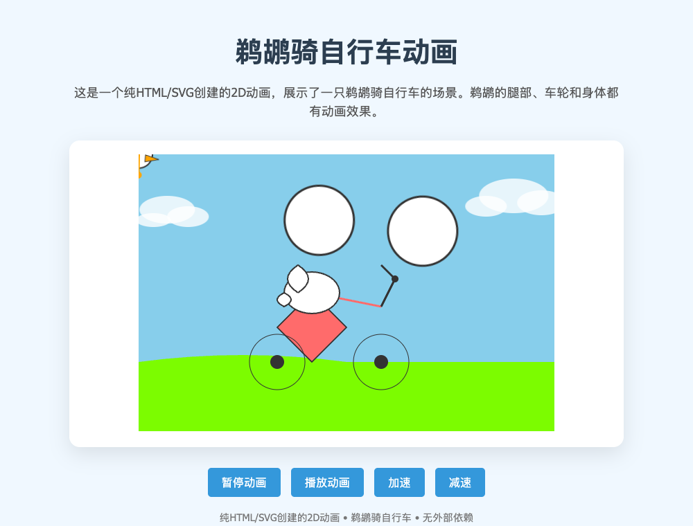

# nano5 鹈鹕：开启思考的同题对照

2026-10-21，按用户要求，在 nano5 上实际运行同一道原题。没有给模型输入旧 HTML、其他项目代码或额外 SVG 提示。
原题：`创建一个HTML，内容是SVG绘制一个鹈鹕骑自行车的2D动画，不许参考任何本机其他项目直接自己搞`。

参数与上一轮 fast-8k 保持一致：8K、window56、bank64、ubatch4、rows4、draft3、seed42、
temperature0.7、top_p0.95、top_k100、repeat_penalty1.03；生成预算6144。
仅将 reasoning 从 off 改为 on。模板使用同一个 SHA256 校验后的官方模板，路径由实验副本改为固定发布目录。
没有修改线上默认参数或接口。

| 指标 | 上一轮不思考 | 本轮开启思考 |
|---|---:|---:|
| 端到端（推理进程，含加载） | 390.42秒 | 555.48秒 |
| 输出token | 2730 | 3653，含思考和解释 |
| Decode token/s | 7.29 | 6.76 |
| 输入token | 38 | 36 |
| 输出上限 | 6144 | 6144 |
| 画面验收 | 未通过 | 未通过 |

本轮 stdout 确实包含 Start thinking / End thinking；正常提前结束，rc=0，无截断、OOM或内存保护退出。
最低 MemAvailable 671.88MiB，DSpark接受率75.03%。这是单个样本，不能推断思考模式在所有任务上更差。

## 浏览器检查

[原始HTML](pelican.html) 是从模型 stdout 中原样提取 DOCTYPE 至 closing html 的连续内容，没有修改。
完整[原始输出](nano-pelican-thinking.out)、[参数和耗时](nano-pelican-thinking.json)、[提取校验](extraction.json)均保留。

- 车轮外圈围绕错误中心运动，与固定的轮轴分离，跑到空中。
- 鸟头所在分组同时使用 SVG translate 与 CSS transform 动画，头部偏出场景。
- 加减速处理代码的模板字符串中有多余右括号，浏览器报 `Missing } in template expression`。
  整段 script 无法解析，暂停/播放/加减速的事件监听都没有注册；实际点击暂停后动画仍运行。
- CSS动画仍然运行，共8项；这不代表实现了正确骑行动作。没有外部网络请求。
- [0ms截图](frame-0.png)、[约700ms截图](frame-700.png)、[约2000ms截图](frame-2000.png)、[移动宽度截图](frame-mobile.png)、[浏览器记录](browser-check.json)。

## 互斥与恢复

本次管理员实验先通过原中央协调器预约同一 `nano5-igpu` 资源，使用原控制器完成 ComfyUI → MiniCPM。
启动前确认 ComfyUI 为 inactive、MainPID=0。推理期间控制器对未通过HTTP启动的管理员CLI保守上报未知忙碌，
中央独占租约始终保持；没有绕过资源预约同时运行两个模型。
推理退出后确认无 llama 进程，再释放原租约，最后通过正式HTTP接口切回 ComfyUI，耗时24.57秒。
最终 comfy / ready / active=0，原租约为released。见[操作回执](lease-proof.json)。

结论：这一次仅开启思考没有改善鹈鹕动画的正确性，新增按钮也有脚本错误。保留现有非思考默认配置。
